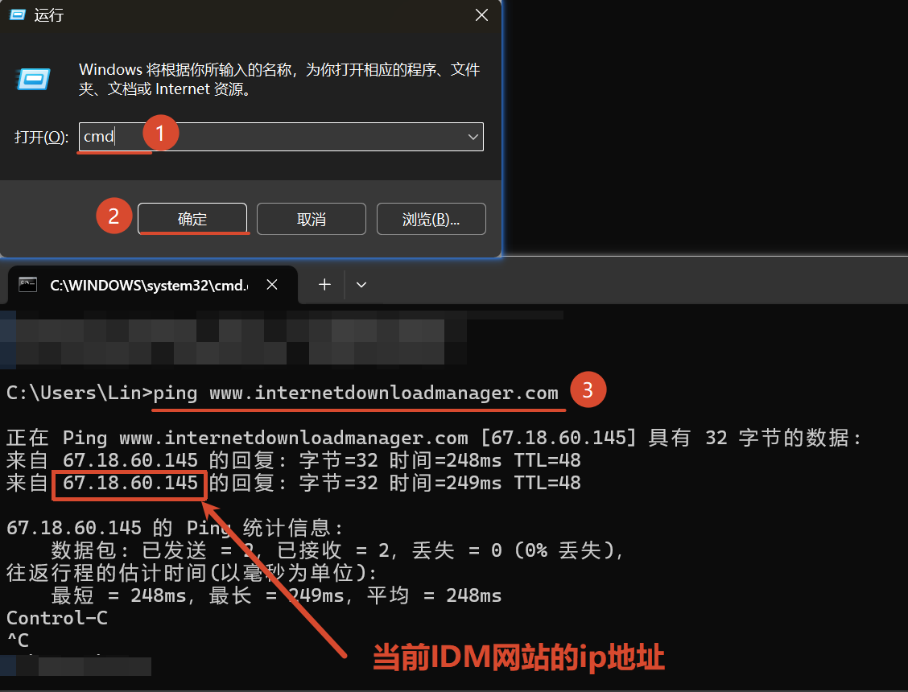

# 一、下载
## 本体
[IDM官网](https://www.internetdownloadmanager.com/)
## Crack
IDM_6.4x_Crack

# 二、关闭更新（防火墙拦截）
## 2.1 获取IDM的ip
步骤1：同时按下`Win键`和`R键`，打开 **运行** 界面
步骤2：输入`cmd`，并键入`回车键`。此时弹出**cmd**界面
步骤3：执行`ping www.internetdownloadmanager.com` 
步骤4：回显中的ip地址，就是IDM网站的最新IP地址

## 2.2 建立防火墙出站规则
步骤1：同时按下`Win键`和`S键`，输入`控制面板`，来打开`控制面板`
步骤2：在**控制面板**界面，点击`Windows Defender 防火墙`
步骤3：在**Windows Defender 防火墙**界面，点击`高级设置`。此时弹出`高级安全 Windows Defender 防火墙`
步骤4：点击`出站规则`，在右侧找到并点击`新建规则`。按照下一章节设置规则
## 2.3 自定义出站规则
规则类型：自定义
程序：找到IDMan.exe（即IDM安装地址）
协议和端口：默认（即不作修改）
作用域：应用于哪些远程IP地址-->下列IP地址-->添加-->此IP地址或子网-->IDM网站的最新IP地址
操作：阻止连接
配置文件：默认（即不作修改）
名称：自定义（block_IDMapp_link_IDMweb）